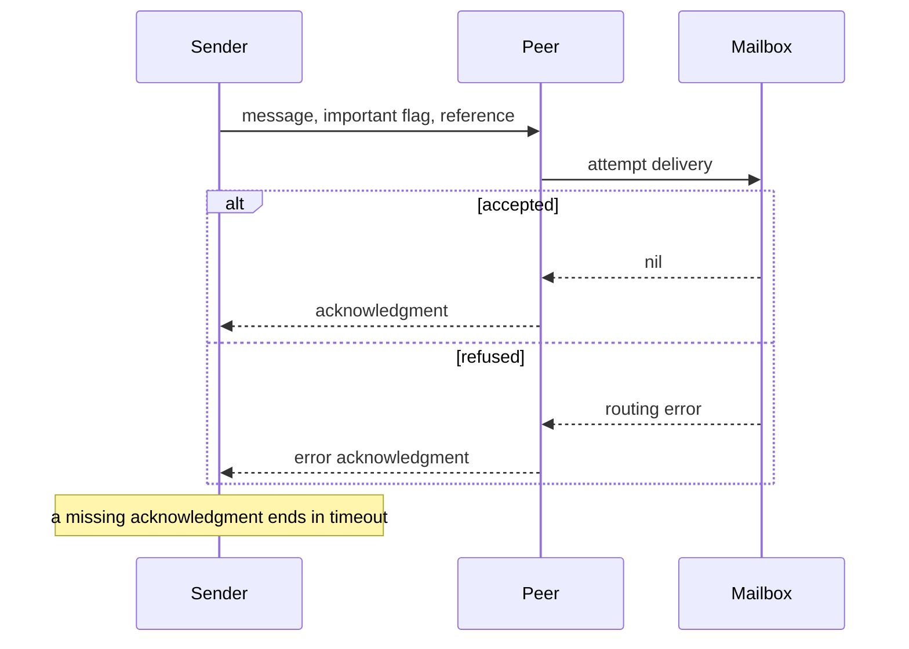
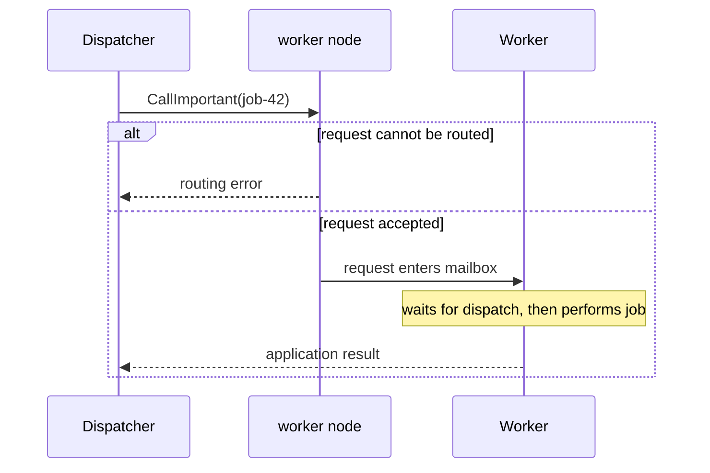

# Important Delivery

A successful ordinary remote `Send` means the message was passed to the node connection. It does not tell the sender whether the remote recipient exists or has space in its mailbox. Important delivery requests a report of that delivery attempt.

The distinction matters when a worker must decide whether to keep or retry a job. Confirmation establishes that the recipient accepted a message. It does not establish that a handler ran, a database write committed or a response was processed. A timeout leaves the outcome unknown.

Before choosing a delivery method, consider a dispatcher on node A that submits a job to a worker on node B. There are three separate events: the worker's mailbox accepts the job, the worker performs it, and the dispatcher learns the result. A connection can fail between any two of them.

If the dispatcher only needs to learn whether node B accepted the submission, it can use `SendImportant`. If it needs the job's result, it should make a request. If it must survive a lost answer without repeating the work, the application also needs an operation ID and a way to recover the recorded result. We will follow these cases in order.

## The Problem: Network Opacity

Local delivery can report a missing process or full mailbox during the routing operation. Across a node connection, those facts are known on the receiving node. Ordinary remote sends do not send its routing result back:

```go
err := process.Send(remotePID, message)
if err != nil {
    // Handle a routing, connection or encoding error.
}
// nil does not confirm acceptance by the remote recipient.
```

A request sent with `Call` may time out because its recipient was missing, because a handler was slow or because the answer could not return. Those cases require different recovery decisions, but the timeout alone does not distinguish them.

## The Solution: Confirmed Delivery

`SendImportant` waits for the receiving node's delivery result:

```go
err := process.SendImportant(remotePID, message)
switch {
case err == nil:
    // Routing succeeded. Processing may still be pending; see fallback below.
case errors.Is(err, gen.ErrProcessUnknown):
    // The receiver reported that the process was missing.
case errors.Is(err, gen.ErrProcessMailboxFull):
    // The receiver reported that the mailbox could not accept the message.
case errors.Is(err, gen.ErrTimeout):
    // The result is unknown. The message may have been accepted.
default:
    // Handle the returned routing or transport error.
}
```

For our dispatcher, with no mailbox fallback configured, `nil` means that node B accepted the submission into the worker's mailbox. The job may still be waiting behind other messages. To learn that it finished, the dispatcher needs an application response describing that outcome.

A recipient can configure `ProcessOptions.Fallback` to route messages elsewhere when its mailbox is full. In that case, a successful routing report can mean that the fallback process accepted a `gen.MessageFallback`, rather than that the original worker accepted the job. Important delivery reports the runtime's routing result; it follows the recipient's fallback policy. See [Process](../basics/process.md) for mailbox configuration.

Now suppose node B accepted job `job-42`, but the connection failed before its acknowledgment reached node A. `SendImportant` times out. The job may already be running; sending it again under a new ID could run it twice. Keep the original ID when retrying and let the worker look up work already accepted or completed. The lookup and duplicate handling belong to the application; the runtime does not store job results.

There is another failure window: the worker can terminate after accepting the job and before dispatching it. An acknowledgment still described a successful mailbox delivery. Recovering that job requires a durable queue or another application mechanism that survives the worker's termination.

## How to Use Important Delivery

Use `SendImportant` for a selected message or `CallImportant` for a selected request. `SetImportantDelivery(true)` enables the flag for the process's ordinary sends, calls and responses:

```go
func (a *worker) Init(args ...any) error {
    a.SetImportantDelivery(true)
    return nil
}
```

Remote important delivery requires the participating peers to advertise `NetworkFlags.EnableImportantDelivery`. It is enabled in the default flags. A send to a peer without that support can return `gen.ErrUnsupported`; copying the default flag set before adjusting it avoids accidentally clearing other capabilities. See [Network Stack](../networking/network-stack.md#network-configuration).

A request's flag does not enable the responder's flag. Configure the responder separately or use `SendResponseImportant` explicitly when it needs a report about its answer.

## How Important Delivery Works

### Send with Important Delivery

For a remote send, the runtime allocates a reference, sends the message and waits up to `gen.DefaultRequestTimeout` (five seconds by default). The peer attempts routing and returns an acknowledgment with that result.



While waiting, the sending actor does not dispatch other mailbox messages. Other processes on its node continue running.

### Call with Important Delivery

Change the dispatcher so it asks the worker to execute the job and return a result:

```go
result, err := process.CallImportant(remotePID, Job{ID: "job-42"})
```

Here `Job` is the application's request type. Register it on both nodes before establishing their connection; see [Message Versioning](message-versioning.md) for type registration. The worker handles it through the same `HandleCall` callback used for a local request.

`CallImportant` waits for the application response, as `Call` does. If remote routing fails, the peer returns that error rather than leaving the caller to wait for a response that cannot be produced. Successful request delivery does **not** produce a separate positive acknowledgment.

Follow the request through a working connection:



The dispatcher remains blocked until it receives an answer or an error, or its deadline passes. A returned result is evidence of an answer, so the application should define what that answer means: merely queued, completed, or committed to durable storage. The runtime cannot infer this from the result's Go type.

If the worker completed `job-42` but its answer was lost, the caller still sees a timeout. `CallImportant` makes a missing recipient easier to diagnose; it does not resolve uncertainty about work performed after acceptance.

## Combining Call and Response Delivery

Request and response flags cover different routing attempts:

| Request | Response | Additional information |
|---------|----------|------------------------|
| Ordinary | Ordinary | Caller receives an answer or a call error; responder does not wait for response acknowledgment |
| Ordinary | Important | Responder waits for acceptance of its answer |
| Important | Ordinary | Caller can receive the peer's request-routing error |
| Important | Important | Request-routing errors are reported and the responder waits for acceptance of its answer |

### Regular Call + Regular Response

Return the result from `HandleCall` when the responder does not need a response-delivery report:

```go
func (h *handler) HandleCall(from gen.PID, ref gen.Ref, request any) (any, error) {
    return h.process(request), nil
}
```

The second return value is a termination reason, not an application error for the caller. See [Sync Request Handling](handle-sync.md).

### Regular Call + Important Response

Send the response explicitly to handle its delivery error in the callback:

```go
func (h *handler) HandleCall(from gen.PID, ref gen.Ref, request any) (any, error) {
    result := h.process(request)
    if err := h.SendResponseImportant(from, ref, result); err != nil {
        h.Log().Warning("response not confirmed: %s", err)
        // Retain or reconcile the operation's status according to the protocol.
    }
    return nil, nil // the response was sent explicitly
}
```

A nil return from `SendResponseImportant` confirms acceptance of the answer. `ErrResponseIgnored` can indicate that the caller no longer has the request pending. A timeout remains ambiguous: the answer may have arrived and its acknowledgment may not have returned.

### Important Call + Regular Response

`CallImportant` asks the peer to report request-routing failures. After successful routing, the caller waits for the ordinary response. It receives no intermediate success indication.

### Important Call + Important Response

With both flags enabled, the dispatcher can learn about request-routing failure and the worker can learn about response-delivery failure. The two reports help different processes decide what to do next.

Suppose the worker has finished `job-42` and `SendResponseImportant` times out. Undoing the job would be unsafe: the dispatcher might already have received the answer and started its next operation. Retain the recorded result so that a later status request or retry can recover it. An acknowledgment confirms a routing event; it is not a vote to commit or roll back an application transaction.

## Recovering an Uncertain Job Outcome

Delivery acknowledgments alone are insufficient to establish a transaction outcome. For example, a participant can commit and then lose the connection before returning its response. The coordinator sees an error even though the write happened.

A transaction protocol needs its own durable state, operation identifiers, duplicate handling and recovery rules. Important delivery supplies routing information to that protocol; it does not remove uncertainty about application effects. For `job-42`, one possible recovery protocol is:

1. The dispatcher assigns an ID before its first submission and retains it across retries.
2. The worker records that ID and the job's state in storage appropriate to the required durability. A repeated submission checks the existing record before doing work again.
3. After a timeout, the dispatcher asks for the recorded state. A completed job returns its saved result; an in-progress job remains pending.
4. A status that cannot yet be obtained remains unknown. Recovery follows the application's retention and retry rules.

These steps describe an application design, not behavior provided by `act.Actor`. How the record and the external effect become consistent depends on the storage and the job itself. Important delivery supplies the routing reports used by that design.

## Performance Considerations

A remote `SendImportant` adds acknowledgment traffic and a wait in the sender. `CallImportant` sends a routing error only when the request cannot be delivered; it does not add a positive acknowledgment on successful delivery. An important response adds a wait in the responder.

Use these reports where they affect a recovery decision. If the dispatcher also supervises workers or collects other answers, blocking it for each job can delay those duties. `SendRequestImportant` returns a request reference without waiting; the result later arrives in `HandleResponse`. This is an asynchronous request, so the worker still answers through `HandleCall`. It is not a non-blocking substitute for a plain `SendImportant`. [Requests Without Blocking](async-request.md) develops the caller's state and cancellation rules.

## When the Requester Did Not Block

An answer to `SendRequest` goes into the requester's mailbox. An important response is acknowledged when the runtime accepts it there, before `HandleResponse` runs. The requester may terminate before handling it.

A full mailbox can refuse the answer. If the requester's runtime still has the request pending, its deadline later produces a timeout; that timeout also needs mailbox space. The async-request chapter describes this case.

## Local vs Remote Behavior

A local important **send** uses the local routing result without a network acknowledgment. Local delivery can still fail, and success does not wait for handling. Important responses have their own confirmation path, so do not generalize this send behavior to every method carrying the flag.

## Error Types

| Error | What the result establishes |
|-------|-----------------------------|
| `ErrProcessUnknown` | The routing attempt could not find its target |
| `ErrProcessMailboxFull` | The target mailbox refused the delivery attempt |
| `ErrTimeout` | The caller did not obtain a result before its deadline; acceptance or processing may have occurred |
| `ErrResponseIgnored` | The response was not accepted as an answer to a pending request |
| Connection or encoding error | The reported transport operation failed; recovery must account for how far the operation may have progressed |

Match wrapped errors with `errors.Is`. A retry after an unknown outcome should carry the same application operation ID, so the recipient can recognize work already performed.

## Summary

Use the important flag to obtain delivery reports. To confirm processing, ask for an application response. To recover work after an uncertain outcome, define status lookup, persistence and duplicate handling in the application protocol.

Continue with [Sync Request Handling](handle-sync.md) for response semantics and [Message Versioning](message-versioning.md) for contracts between nodes running different code versions.
