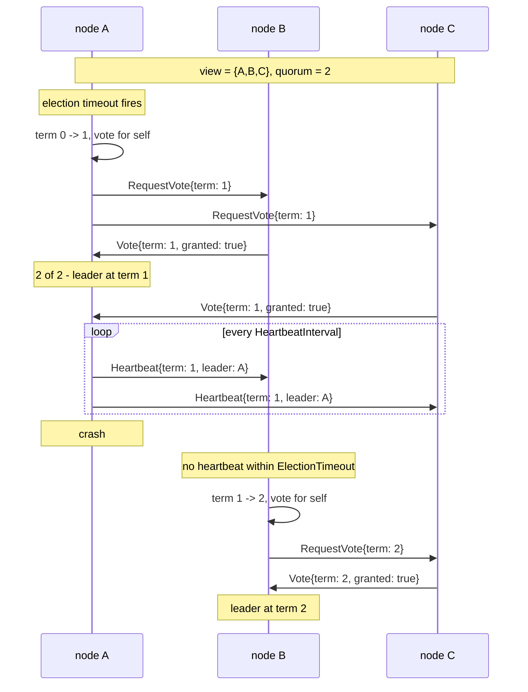

# Leader

The leader actor coordinates elections among actors with the same cluster ID. Each member maintains a view of the peers it knows and requires a majority of that view before taking leadership.

Membership and reachability affect that calculation. This chapter covers discovery, election callbacks and the conditions under which different views can elect different leaders. External writes that require exclusivity need fencing or an authority that can reject a stale leader.

## The Problem

Plenty of work must happen once, not once per node. A scheduler that fires cron jobs. A reconciler that scans a database and dispatches what it finds. A single writer to a resource that cannot take concurrent writers. Run it on every node and you get duplicate jobs, duplicate dispatches, duplicate writes. Run it on one designated node and you have a single point of failure that needs a human to move.

The obvious shortcut is to pick deterministically: sort the node names, lowest one wins. It needs no messages and it is genuinely appealing, right up to the moment two nodes disagree about the list. Node A believes the set is `{A, B, C}` and picks A; node B has just begun suspecting A and believes the set is `{B, C}`, so it picks B. Both act. Nothing in the scheme prevents it, because nothing in the scheme requires anyone to agree.

An election requires grants from other members, rather than each node independently choosing a winner from its reachable peers. This relies on the membership views; overlap alone is not a general guarantee of exclusive leadership.

## How It Works

The actor is a Raft-style election with no log: terms, votes, heartbeats, and nothing replicated.

**Roles.** Every actor is in one of four states.

- `unclustered` - the view is smaller than `MinClusterSize`, so this node may not have a leader at all. Not a failure; a group too small to be a cluster is behaving correctly by not operating as one.
- `follower` - accepting another node's leadership, or waiting to campaign.
- `candidate` - campaigning for a term, waiting for grants.
- `leader` - holding leadership, sending heartbeats.

**The view.** Membership is the set of peers this node has been told about, plus itself. Peers arrive through `Options.Bootstrap` at startup, through `Join` at any time, and through the protocol itself - a node that sends a valid message is a member. A peer counts from the moment it is declared, before it has answered anything.

**Terms.** A term is a logical clock, not a wall clock. A candidate increments it before asking for votes, and a higher term always wins: any node seeing one adopts it and steps back to follower. This is what settles disagreement without a shared clock.

**Quorum.** To win, a candidate needs a majority of its view, counting itself. Three nodes need two votes, four need three, five need three. The denominator is the current view, so it moves as membership changes - and `MinClusterSize` is the floor that stops it moving somewhere useless.



Leadership requires a majority of the local membership view and confirmation through the configured callback. A shared view constrains simultaneous elections, but diverged views can elect independently. `GhostTTL` eventually changes a view after unreachable members are removed.

See [What It Guarantees](#what-it-guarantees) for the consequences of membership changes and external fencing.

## Setup

Register the election protocol before starting the actor, and choose the minimum cluster size explicitly. Missing protocol registration is checked during actor initialization.

### Register the wire types

The package does not register its protocol on import. Register it on the node that runs the actor. Putting the registration in the application spec makes the required types available during application loading, before the group starts. A late registration can be used, but peers must also know the types before decoding them.

The actor checks this at `Init` and refuses to start if its protocol is not registered: an unregistered vote fails to encode on every send, so the alternative is a healthy-looking node that never joins an election.

Declare them on the application that hosts the actor:

```go
gen.ApplicationSpec{
    Name: "scheduler",
    Network: gen.ApplicationNetwork{
        RegisterTypes:  leader.NetworkTypes(),
        RegisterErrors: leader.ErrorTypes(),
    },
    Group: []gen.ApplicationMemberSpec{
        {Name: "coordinator", Factory: factoryCoordinator},
    },
}
```

`ApplicationSpec.Network` is processed during `ApplicationLoad`, before the application's processes spawn. You can also register directly on the node; check the returned errors and finish registration on all participating nodes before sending election traffic:

```go
node.Network().RegisterTypes(leader.NetworkTypes())
node.Network().RegisterErrors(leader.ErrorTypes())
```

`ErrorTypes()` returns nothing today - the actor sends no sentinel errors over the wire. It exists so your setup code stays uniform if that changes.

### Set MinClusterSize

`MinClusterSize` is the smallest view - this node plus the peers it knows - that may have a leader at all. The default is 3: the smallest size whose majority, two, survives losing one node.

Lower values are permitted with warnings:

- `1` lets a lone node appoint itself. A single-node deployment must set this explicitly, and nothing then prevents a fragment of one from operating alone.
- `2` gives a quorum of two out of two, so losing either node ends leadership. Sensible only when an external authority gates leadership through `HandleConfirmLeader`.

Set the value according to the membership and failure policy of the deployment.

## Basic Usage

```go
package main

import (
    "time"

    "ergo.services/actor/leader"
    "ergo.services/ergo"
    "ergo.services/ergo/gen"
)

type coordinator struct {
    leader.Actor

    running bool
}

type messageDiscoverPeers struct{}

func factoryCoordinator() gen.ProcessBehavior {
    return &coordinator{}
}

func (c *coordinator) Init(args ...any) (leader.Options, error) {
    // Join from a handler frame, not from here: the options below have not been
    // applied yet, so a vote sent from Init would carry an empty ClusterID and be
    // dropped by the receiver's own guard.
    if err := c.Send(c.PID(), messageDiscoverPeers{}); err != nil {
        return leader.Options{}, err
    }

    return leader.Options{
        ClusterID:      "scheduler",
        MinClusterSize: 3,
    }, nil
}

func (c *coordinator) HandleMessage(from gen.PID, message any) error {
    switch message.(type) {
    case messageDiscoverPeers:
        for _, node := range discoverNodes() { // your discovery, whatever it is
            c.Join(gen.ProcessID{Name: "coordinator", Node: node})
        }
        // Re-run it: peers appear and disappear, and a node that starts before its
        // peers must keep looking.
        if _, err := c.SendAfter(c.PID(), messageDiscoverPeers{}, 5*time.Second); err != nil {
            return err
        }
    }
    return nil
}

func (c *coordinator) HandleBecomeLeader() error {
    c.Log().Info("became leader at term %d", c.Term())
    c.running = true
    return c.Send(c.PID(), messageTick{})
}

func (c *coordinator) HandleBecomeFollower(leader gen.PID) error {
    c.Log().Info("no longer leader, following %s", leader)
    c.running = false
    return nil
}

func main() {
    node, err := ergo.StartNode("n1@localhost", gen.NodeOptions{})
    if err != nil {
        panic(err)
    }
    defer node.Stop()

    node.Network().RegisterTypes(leader.NetworkTypes())
    node.SpawnRegister("coordinator", factoryCoordinator, gen.ProcessOptions{})

    node.Wait()
}
```

`Join` runs after initialization has applied the options. Repeat discovery so nodes that start before their peers can find them later. `HandleBecomeFollower` stops the work begun by `HandleBecomeLeader`.

## Configuration

```go
leader.Options{
    ClusterID:          "scheduler",  // required
    MinClusterSize:     3,            // default 3
    Bootstrap:          peers,        // optional, []gen.ProcessID
    ElectionTimeoutMin: 150,          // ms, default 150
    ElectionTimeoutMax: 300,          // ms, default 300
    HeartbeatInterval:  50,           // ms, default 50
    GhostTTL:           5000,         // ms, default 5000
}
```

**ClusterID** is required and namespaces the election. Messages carrying a different one are dropped and counted, so two logically separate groups can share a network without interfering. Give distinct clusters distinct ids; sharing one by accident merges them.

**MinClusterSize** - see [Set MinClusterSize](#set-minclustersize) above.

**Bootstrap** is a static list of peers, and it is exactly `Join` declared up front: the entries seed the same membership rather than being a second, parallel set of targets. Use it when the peer set is known at deploy time; use `Join` when it is discovered at runtime; use both if some of it is known and some is not.

**ElectionTimeoutMin / ElectionTimeoutMax** bound the randomised wait before a follower campaigns. Randomising it is what stops every node timing out at the same instant and splitting the vote. Set only one and the other is derived - min alone doubles to a max, max alone halves to a min - so a partial configuration resolves instead of failing at startup.

**HeartbeatInterval** is how often a leader asserts itself. It must be comfortably smaller than `ElectionTimeoutMin`, or followers will time out between heartbeats and campaign against a healthy leader; the actor warns at startup if it is not.

**GhostTTL** is how long a peer whose connection dropped stays in the view before being dropped. It exists because those two things - a blip and a departure - look identical from here, and neither extreme works: keep an unreachable peer forever and, with dynamic node names, the view fills with names that will never return until quorum exceeds the number of nodes that exist; drop it immediately and a one-second blip lowers quorum. Five seconds separates the cases - far longer than a 150-300 ms election cycle, far shorter than a stage of a rolling deploy.

`GhostTTL` bounds how long an unreachable peer contributes to the view. Before expiry, a departed member may prevent quorum. After expiry, the smaller view may elect independently. Use `Leave` for known departures, and use fencing for exclusive external effects.

The defaults suit a local network. On a pod-to-pod network across zones, or anywhere a garbage-collection pause can exceed a couple of hundred milliseconds, raise all three together - for example 1000 / 2000 / 300. Aggressive timeouts do not make failover safer, they make spurious elections more likely.

## ActorBehavior Interface

```go
type ActorBehavior interface {
    gen.ProcessBehavior

    Init(args ...any) (Options, error)
    HandleMessage(from gen.PID, message any) error
    HandleCall(from gen.PID, ref gen.Ref, request any) (any, error)
    Terminate(reason error)
    HandleInspect(from gen.PID, item ...string) map[string]string

    // Leadership
    HandleConfirmLeader() (bool, error)
    HandleBecomeLeader() error
    HandleBecomeFollower(leader gen.PID) error

    // Membership
    HandlePeerJoined(peer gen.PID) error
    HandlePeerLeft(peer gen.PID) error

    // Framework message classes
    HandleEvent(event gen.MessageEvent) error
    HandleSpan(span gen.TracingSpan) error
    HandleLog(message gen.MessageLog) error
}
```

Only `Init` has no default - embedding `leader.Actor` satisfies the rest. `HandleBecomeLeader` and `HandleBecomeFollower` do have defaults, but they log a warning, because winning leadership and doing nothing with it is almost always a missing implementation rather than an intention.

**HandleBecomeLeader** is where the singleton work starts. Returning an error rolls the transition back: the actor steps down again and the error terminates it, so use it to refuse leadership you cannot honour.

**HandleBecomeFollower** is where it stops, and it fires on every transition into follower - not only when a leader is demoted. A follower whose leader disappeared and a candidate that stood down both arrive here, with an empty PID when no leader is known. Make it idempotent.

**HandleConfirmLeader** is consulted after this node has won the election and before leadership is published. Returning `false`, or an error, withholds it: `HandleBecomeLeader` does not run and the node re-campaigns after a backoff that grows with consecutive denials. An error counts as a denial, not as consent - the usual error is a timeout talking to whatever you are asking, which is exactly when someone else may be holding it. See [Leadership Safety](#leadership-safety).

**HandlePeerJoined / HandlePeerLeft** report membership changes. They are informational; membership is already applied by the time they run.

## Membership

Discovery belongs to your code. The actor's job is to negotiate with the names you give it.

**`Join(peer gen.ProcessID)`** declares a peer and opens negotiation. The peer counts toward the view immediately, before it has answered - which is what lets a node reach `MinClusterSize` without needing traffic that only a campaigning node produces. Idempotent per node.

**`Leave(node gen.Atom)`** withdraws a peer from the view and from every quorum computed afterwards. Call it when your discovery stops listing a node: you know the pod is gone, the actor can only guess. A withdrawal is sticky for one election timeout, so traffic already in flight cannot re-admit what you just removed.

**A peer going down** is handled by reason. A death reported with an actual reason - the remote process terminated - removes the member immediately. A drop reported as `gen.ErrNoConnection` does not: the member stays in the view, with only the knowledge of how to reach it forgotten, and is dropped after `GhostTTL` if it has not come back. Silence alone never shrinks the view inside that window, because shrinking it lowers quorum and would let a momentary blip hand a fragment the ability to elect.

**With dynamic node names this matters more than it looks.** Where every pod gets a name that will never be reused - `$(POD_NAME)@$(POD_IP)` and the like - a replaced pod leaves an unreachable member behind, and the framework reports everything on a lost node as `ErrNoConnection` whatever actually happened to it. Without a bound, two rolling deploys of a five-node cluster leave a view of thirteen and a quorum of seven that the five living nodes can never assemble - a cluster that is permanently leaderless and looks healthy field by field. `GhostTTL` bounds it, and calling `Leave` from your discovery loop closes it properly.

**Heartbeats go only to peers that have answered.** A declared peer that has never replied is not a follower: there is no election timer of yours to suppress, and if it is up it will campaign and be corrected by the reply. Vote requests do go to everyone declared, because reaching out is the whole point of a campaign.

## What It Guarantees

A candidate needs a majority of its current membership view to win an election. A voter grants one vote per term. While members share that view, two disjoint groups cannot each collect a majority of the same set.

An active leader also checks recent contact with a quorum. If it cannot reach enough members, it steps down on a heartbeat tick. Election and heartbeat callbacks must be able to run for these checks to take effect; a blocked callback delays the check.

The membership view is dynamic. An unreachable peer initially remains in it, but `GhostTTL` eventually removes that peer and lowers the quorum denominator. `Leave` also removes a member. After a long partition, two sides can therefore have different views and elect separately if both views satisfy `MinClusterSize`.

For example, six members can split into two groups of three. Before ghost expiry, each group needs four votes and neither can elect. After each group removes the unreachable members, each needs two votes and can elect with the default `MinClusterSize: 3`. The original six-node view no longer provides a shared quorum constraint.

If the deployment has a fixed maximum of six distinct members, setting `MinClusterSize: 4` prevents either three-member fragment from qualifying. That trades availability for a stricter membership floor. It is not a durable lease, and it does not fence a stale leader's writes to an external resource.

The actor replicates no application state and persists no election state. A restarted process rejoins with fresh in-memory state. Store any job progress that a successor needs outside the leader process, and protect external effects as described below.

## Leadership Safety

A leadership callback tells an actor what role its election currently assigns it. An external database or queue does not observe that transition automatically. A process can start a write while leading, lose leadership, and have the write complete later. Different membership views can also elect leaders independently.

Use `HandleConfirmLeader` when an external authority must approve leadership after the election:

```go
func (c *coordinator) HandleConfirmLeader() (bool, error) {
    return c.lease.Held(), nil // application-managed, locally cached authority
}
```

Here `c.lease` is an application component, not part of the leader package. The callback runs when the actor wins an election. It is not a periodic renewal check. Keep the authority's state current separately and arrange for the application to stop leader work when that authority is lost. Bound any network operation in the callback: while it waits, the actor cannot dispatch election messages.

Where stale writes must be rejected, the resource needs fencing. An authority assigns increasing tokens to successive holders, and every protected write carries its token. The resource checks the token as part of the write, rather than relying on the actor to check `IsLeader` just before sending it.

For example, an application might use an atomic update of this form:

```sql
UPDATE resources
SET value = :value, owner_token = :token
WHERE id = :id AND (owner_token IS NULL OR owner_token <= :token)
```

Once a newer token has been recorded, this predicate refuses an older holder's write. Equal tokens allow further writes by the same holder. The application must obtain tokens from an authority that orders holders, and must use the check on every relevant write. The actor's in-memory term alone is not such an authority across restarted processes or independent membership views.

## Partitions and Healing

Take a five-node cluster, `{A,B,C,D,E}`, `MinClusterSize: 3`, A leading at term 4. The network splits into `{A,B,C}` and `{D,E}`.

**The majority side.** A still reaches B and C: two peers plus itself is three, a majority of its view, so it keeps leadership at term 4. Nothing changes for the work it is running.

**The minority side.** D and E stop hearing heartbeats and campaign. Initially their views stay at five, so they need three votes and cannot win with only two. After `GhostTTL`, their views can shrink to two. With `MinClusterSize: 3`, they become `unclustered` rather than electing. This floor matters: with a floor of two, the smaller side could elect after its view shrinks.

While both sides retain the same view, two disjoint groups cannot each hold a majority. This reasoning no longer applies after their views diverge, including through ghost expiry; see [What It Guarantees](#what-it-guarantees).

**Healing.** Connectivity returns. Each side rediscovers the other through the protocol: a vote request or heartbeat resolves the peers, the views grow back to five, and quorum returns to three. If the far side had elected a leader at a higher term, the term comparison settles it - A adopts the higher term and steps down, and one leader remains. If nobody outranked A, its heartbeats simply reach D and E again and they follow.

**What a leader on the wrong side does.** If A had ended up in the minority instead, its heartbeat tick would have found fewer reachable members than its quorum requires, and it would have stepped down on its own within one election timeout - without needing to hear from the majority side.

## API Methods

State, all safe to call from within your callbacks:

```go
c.IsLeader()      // bool
c.Leader()        // gen.PID of the leader this node recognises, zero if none
c.Term()          // uint64
c.ClusterID()     // string
```

Membership:

```go
c.Peers()         // []gen.PID of the peers whose PID is known
c.PeerCount()     // int
c.HasPeer(pid)    // bool
c.Bootstrap()     // []gen.ProcessID as configured
c.Join(procID)    // declare a peer
c.Leave(node)     // withdraw one
```

Messaging:

```go
failed, err := c.Broadcast(message)
```

`Broadcast` sends to every member of the current view, addressing each by PID where known and by name otherwise, and returns how many targets failed together with the first error. It does not stop at the first failure.

Exit handling:

```go
c.SetTrapExit(true)   // an exit from anyone but the parent arrives as a message
c.TrapExit()          // bool
```

Off by default, in which case any exit signal terminates the actor. Turn it on when the actor links to children whose failure should not remove this node from the cluster - an application group member is not restarted, so an untrapped exit takes the node out of the election for good.

## Common Patterns

### Leader-only work

Start on promotion, stop on demotion, and check on every tick rather than trusting a flag set long ago:

```go
func (c *coordinator) HandleBecomeLeader() error {
    return c.Send(c.PID(), messageTick{})
}

func (c *coordinator) HandleMessage(from gen.PID, message any) error {
    switch message.(type) {
    case messageTick:
        if c.IsLeader() == false {
            return nil // demoted between ticks
        }
        c.doWork()
        _, err := c.SendAfter(c.PID(), messageTick{}, time.Second)
        return err
    }
    return nil
}
```

### Forwarding to the leader

A request can arrive at any node. Handle it locally when you lead, forward when you do not, and reject when there is no leader - do not queue for one that may never appear:

```go
func (c *coordinator) HandleCall(from gen.PID, ref gen.Ref, request any) (any, error) {
    if c.IsLeader() {
        return c.handle(request), nil
    }
    leader := c.Leader()
    if leader == (gen.PID{}) {
        return nil, gen.ErrNotAllowed // no leader right now
    }
    return c.Call(leader, request)
}
```

### Draining before standing down

`HandleBecomeFollower` runs on the actor's goroutine, so it cannot wait for in-flight work. Mark the actor as not leading, let the work notice on its next step, and keep the teardown itself immediate:

```go
func (c *coordinator) HandleBecomeFollower(leader gen.PID) error {
    c.running = false // the tick handler checks this and stops rescheduling
    return nil
}
```

## Observability

`HandleInspect` reports the full election state. Passing item names returns only those keys; pass `help` for the list, and an unknown item comes back as `<unknown item>` rather than silently missing.

The keys, grouped by what they answer:

- **Role and term** - `ergo:state` (`leader`, `candidate`, `follower`, `unclustered`), `ergo:leader` (this node's own belief, as a boolean), `ergo:leader_pid`, `ergo:leader_node`, `ergo:term`, `ergo:voted_for`, `ergo:term_changed_at`
- **Membership** - `ergo:cluster` (the cluster id this actor belongs to), `ergo:view_size`, `ergo:quorum`, `ergo:min_cluster_size`, `ergo:peers`, `ergo:peers_list`, `ergo:declared`, `ergo:bootstrap`, `ergo:unreachable` (each member whose connection dropped, with how long ago), `ergo:ghost_ttl`
- **The current election** - `ergo:votes_granted`, `ergo:votes_count`
- **Liveness** - `ergo:election_timer_armed`, `ergo:heartbeat_timer_armed`, `ergo:heartbeat_in_last`, `ergo:heartbeat_out_last`, `ergo:election_timeout_min`, `ergo:election_timeout_max`, `ergo:heartbeat_interval`
- **Problems** - `ergo:dropped_by_reason` (per-reason counters for every message the actor discarded), `ergo:send_failing_peers`, `ergo:confirm_denied`, `ergo:last_denied_at`

Three of those are worth knowing about before you need them. `ergo:state` distinguishes a stuck candidate from a healthy follower, which a boolean cannot. `ergo:election_timer_armed` distinguishes a node waiting to campaign from one that has stopped. And `ergo:dropped_by_reason` is often the only trace a discarded message leaves anywhere.

The election state uses the reserved `ergo:` prefix, the same convention the core behaviors follow. When embedding `leader.Actor` and overriding `HandleInspect()`, your keys are merged on top of base inspection data, so your own fields sit beside the election state and one of its keys is replaced only if you name it with the prefix.

For guidance on designing your own inspection surface, see [Inspecting Actor State](../../advanced/inspecting-state.md).

## Observer Integration

[Observer](../../advanced/observer.md) shows the election state of any leader actor in the process view, updating live, and the process kind reflects the role - `leader`, `follower` or `candidate` - so a stuck candidate is visible in a process list without opening it.

## MCP

The [MCP surface of Observer](../applications/observer.md) exposes the same inspection as resources and tools an AI agent asks for on demand, across every node in the cluster from the one node that serves it. For a leader actor that means the whole election can be read in one pass: which node each replica thinks is leading, at which term, with which view and quorum - which is how a divergence between replicas becomes obvious rather than inferred.
